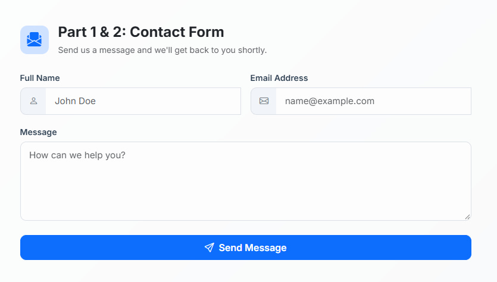
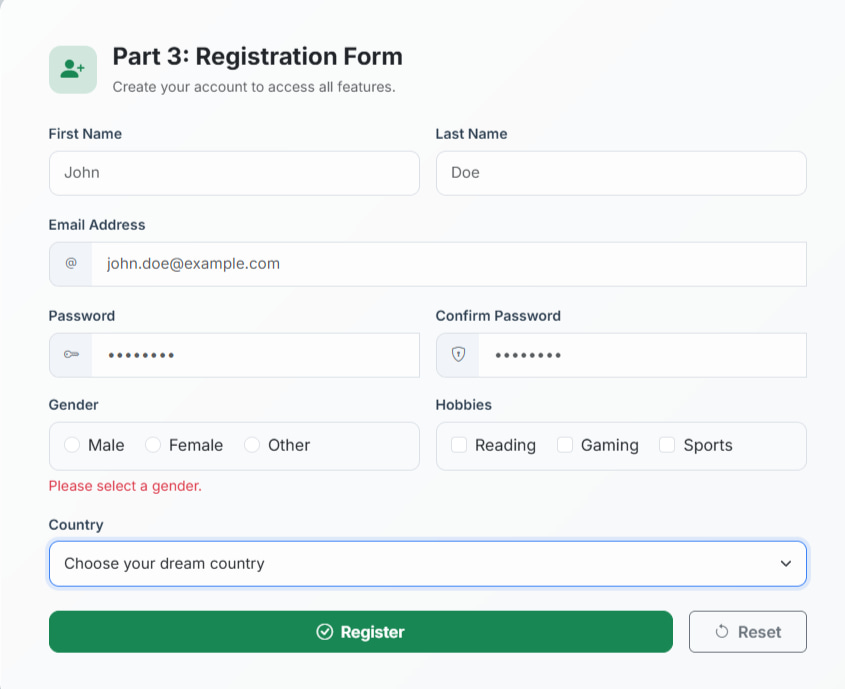

# Assignment #4: Forms and Validation

**Student Name:** Isatay Makhambetuly  
**Group:** IT-2513  

---

## Project Overview
This project demonstrates how to create interactive and responsive web forms using HTML5 and Bootstrap 5. It includes built-in browser validation, custom Bootstrap validation styles, and a script for password matching.

---

## Completed Tasks

### Part 1 & 2: Basic & Bootstrap Contact Form
- **Task 0 & 1:** Built a contact form with `Name`, `Email`, and `Message` fields using `<label>` elements and HTML5 attributes (`required`, `type="email"`, `maxlength`).
- **Task 2 & 3:** Styled the contact form using Bootstrap grid classes (`col-md-6`, `col-12`), input groups, and added Bootstrap validation feedback (`.valid-feedback` / `.invalid-feedback`).

### Part 3: Advanced Registration Form
- **Task 4:** Created a responsive registration form including:
  - First Name & Last Name
  - Email Address
  - Password & Confirm Password (with JS validation)
  - Gender (Radio buttons)
  - Hobbies (Checkboxes)
  - Country (Dropdown select)
  - Submit & Reset buttons

---

## Screenshots

### 1. Contact Form & Validation

### 2. Registration Form & Validation

---

## Summary of Work Process
1. Structured the HTML markup using standard form controls and labels.
2. Applied Bootstrap 5 CSS classes for responsive layouts and custom visual styling.
3. Configured `novalidate` on forms to disable native popups and use Bootstrap validation feedback instead.
4. Wrote a JavaScript snippet to check if the password and confirm password fields match before submission.